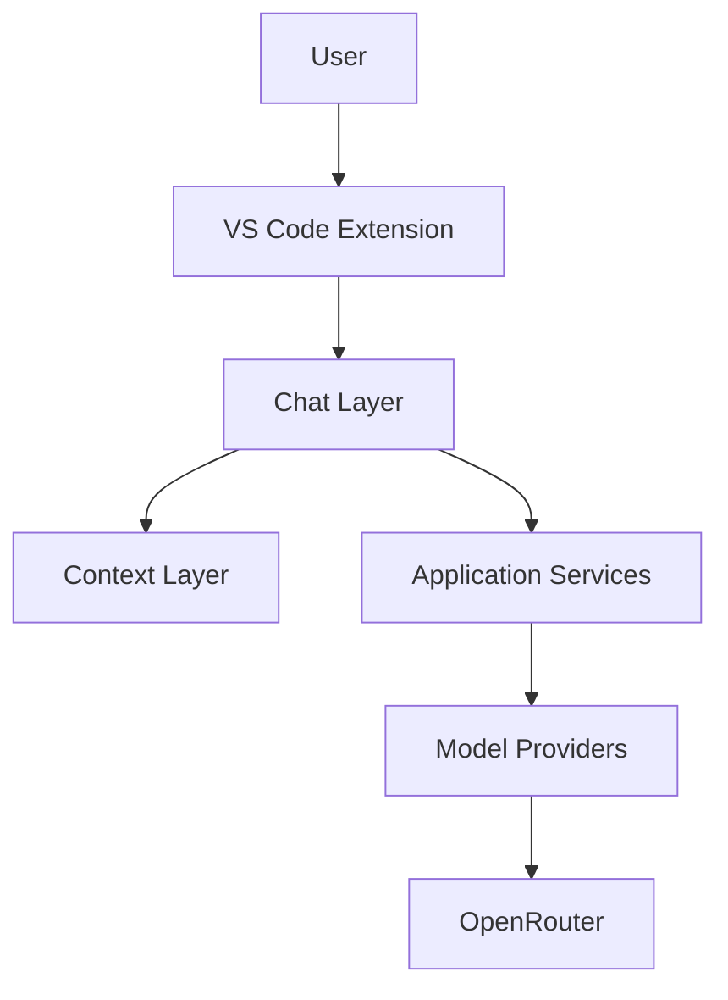
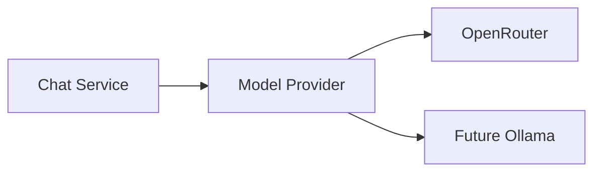
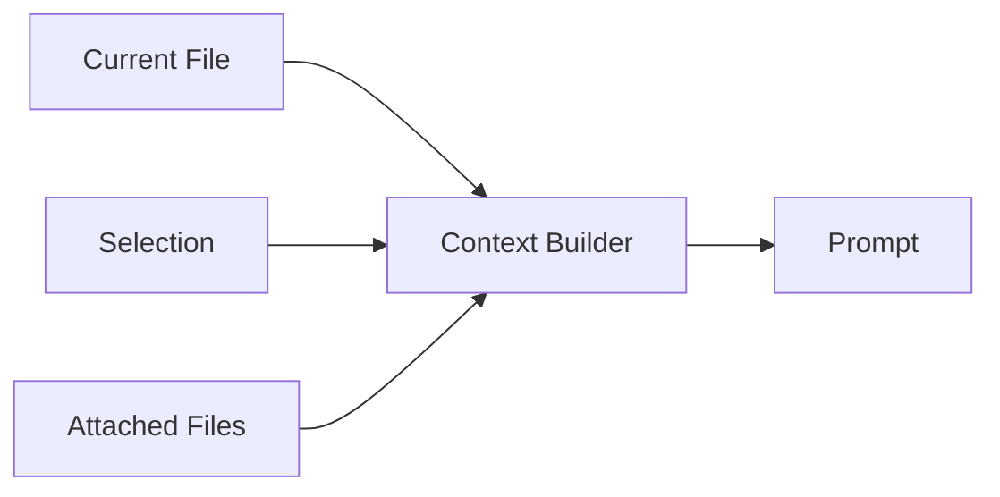
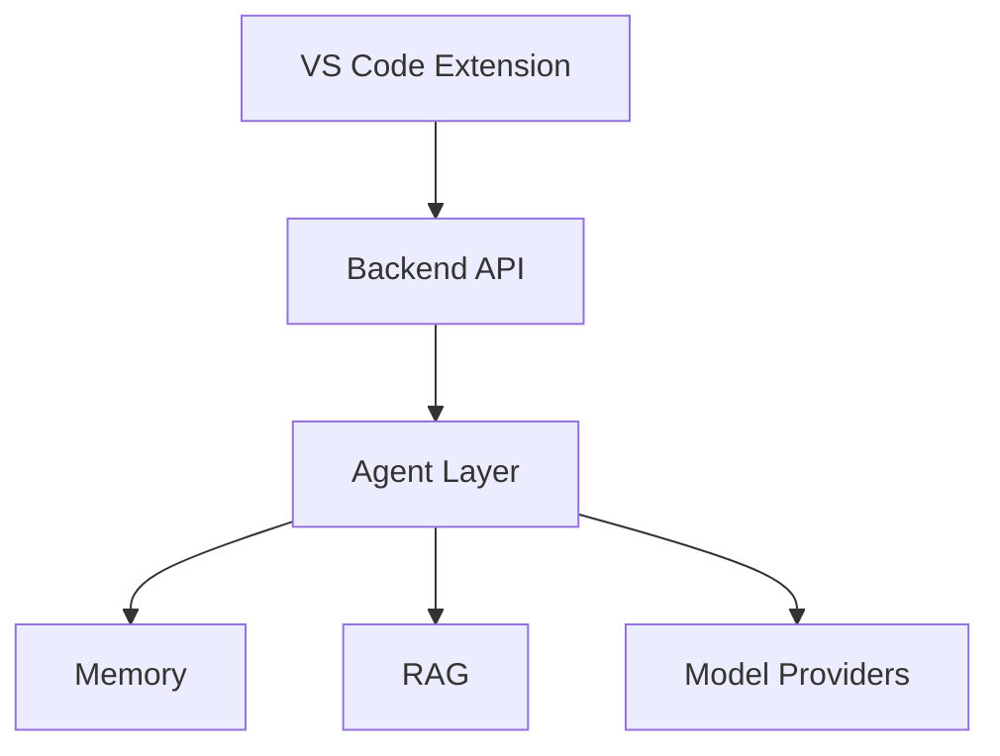

# AI Coding Assistant Architecture

## Overview

This project aims to build a practical AI coding assistant that evolves incrementally from a simple chat-based coding helper into an agentic coding assistant capable of repository exploration, code modification, memory, and RAG.

The architecture follows a pragmatic approach:

- Build the simplest useful solution first.
- Delay complexity until it provides clear value.
- Favor maintainability over architectural purity.
- Keep the project usable at every stage.

---

# Architectural Philosophy

## Core Principles

### KISS

Keep solutions simple.

Avoid introducing infrastructure before it is needed.

---

### YAGNI

Do not build systems for future requirements.

Features should be implemented when they solve a current problem.

---

### DRY

Avoid unnecessary duplication.

Do not introduce abstractions prematurely.

---

### SRP

Modules should have a single responsibility.

---

### Composition Over Inheritance

Favor composition and dependency injection.

Keep inheritance shallow.

---

### Testability

Business logic should be easily testable.

Design for testing from the beginning.

---

# Evolution Strategy

The project intentionally evolves through several stages.


A dedicated backend is intentionally postponed until complexity justifies the separation.

---

# Current Architecture (v0.x)

Initially, the entire application lives inside the VS Code extension.



This architecture minimizes complexity while enabling rapid iteration.

---

# Repository Structure

```text
.
├── .codex
├── .github
├── .husky
│
├── docs
│   ├── roadmap.md
│   ├── architecture.md
│   └── adrs
│
├── memory
│   ├── decisions.md
│   ├── conventions.md
│   ├── lessons-learned.md
│   └── architecture-summary.md
│
├── src
│   │
│   ├── extension
│   │
│   ├── chat
│   │
│   ├── context
│   │
│   ├── models
│   │
│   ├── services
│   │
│   ├── tools
│   ├── types
│   │
│   └── utils
│
├── tests
│
├── AGENTS.md
│
├── package.json
├── tsconfig.json
└── README.md
```

---

# Source Structure

## extension

VS Code integration layer.

Responsibilities:

- Register commands
- Register views
- Activate extension
- UI integration

Avoid placing business logic here.

---

## chat

Conversation management.

Responsibilities:

- Chat sessions
- Message handling
- Response streaming
- Chat orchestration

---

## context

Workspace context collection.

Responsibilities:

- Current file context
- Selected text context
- Attached files
- Workspace metadata

Future responsibilities:

- Repository indexing
- Context compression

---

## models

LLM provider abstraction.

Responsibilities:

- Model communication
- Provider implementations
- Request execution

Example:

```text
ModelProvider
 └── OpenRouterProvider
```

Future:

```text
ModelProvider
 ├── OpenRouterProvider
 └── OllamaProvider
```

---

## services

Business logic layer.

Responsibilities:

- Prompt construction
- Chat execution
- Context assembly
- Future memory orchestration

This is where most application logic should live.

---

## tools

Workspace discovery is independent of chat. The VS Code adapter enumerates a selected
workspace folder and passes directory entries to the discovery service. The service
returns workspace-relative paths and kinds. It skips symbolic links, unknown entry
types, `.git`, and `node_modules`.

Search accepts case-sensitive file names or workspace-relative globs with `*` and
`?` within a path component and `**` for zero or more directory levels. A bare
name or pattern matches file names at any depth. Listing sorts by entry name, and
search visits a directory's files before descending into its subdirectories in
name order. Both report truncation when they leave results or paths unexamined.
The default limits are 200 returned entries, 20,000 entries examined, 1,000
directories visited, and 1,024 characters per relative path. VS Code materializes
each directory listing as an array. Discovery skips conversion and sorting when
a listing would exceed the remaining entry budget, reports truncation, and keeps
results from directories already processed.

Workspace text search uses discovery to choose up to 200 eligible files, then reads
through the same verified file reader as `read_file`. It returns one match per line
with a 1-based line number for a case-sensitive literal query of 1–200 characters.
Results and snippets are capped at 200 matches and 300 characters. It reads at
most a 100 KB prefix per file and 1 MB total, including any probe bytes. The
response reports whether limits left some content unsearched and counts files
skipped because they were unreadable or could not be decoded as UTF-8 text.

## types

Shared TypeScript types.

Responsibilities:

- Interfaces
- DTOs
- Shared type definitions

---

## utils

Generic utility functions.

Avoid placing business logic here.

---

# Dependency Direction

Dependencies should flow downward.

```text
extension
    ↓
chat
    ↓
services
    ↓
models

context
    ↓
services

types
    ↑
shared
```

Business logic should never depend on UI components.

---

# Model Layer

The application communicates with LLMs through a provider abstraction.



Benefits:

- Easier testing
- Future provider support
- Local/cloud routing

---

# Context Pipeline

Context should be assembled consistently.



Future additions:

- Memory
- RAG retrieval
- Workspace search

The repository `read_file` tool shares the verified local file reader used by attachments. The
tool returns a workspace-relative path and up to 100,000 bytes of UTF-8 text. It reports truncation
when more bytes are present. Attachments still reject oversized files. Both features require a
supported local filesystem so they can verify the opened file before reading its contents.

---

# Repository Tool Calls

The chat service passes an explicit list of read-only workspace tools to providers with
streaming tool support. The extension enables this list for a trusted workspace only when the
user opts in. Each turn bounds the number of tool calls, rounds, and result bytes. Structured
requests and results stay in the provider messages for the current turn. Session history keeps
only user messages and visible assistant text. OpenRouter reasoning blocks are passed back in
order when the same turn resumes after tool use.

Model-facing discovery enumerates bounded listings from verified directory handles on Linux
and macOS. Traversal opens path components without following symbolic links. The same verified source
serves file discovery and supplies candidate files for text search.

## Workspace edit previews

A preview validates workspace-relative text file creation, replacement, or ordered
literal patches before reading file contents through the verified workspace reader.
Each patch fragment must match exactly once. A preview records the exact before
and after text for each file and a deterministic display diff. The preview rejects
invalid or oversized text, stale patch fragments, and paths inside `.git`. New
files require an existing, verified parent directory. On Linux, the opened
file's workspace-relative path must match the requested one. On macOS, the
reader opens each component without following symbolic links. The diff shows
line ending and control character changes explicitly. Building a preview
performs no writes.

## Workspace edit approval

The extension keeps a single immutable preview per approval gate. An opaque ID
can be consumed only once. Approval checks every file's saved contents before
starting. Any failure found during those checks stops the batch before the first
write. Each write also rechecks the file and verifies its permissions and
metadata before publication. If a later check or write fails, the result lists
applied, stale, failed, and skipped files. Earlier edits remain applied.

The local macOS writer verifies the pinned workspace identity and opens parent
directories without following symbolic links. It stages the complete file in
its parent and publishes it atomically. Creation is exclusive. Replacement
preserves ordinary permission bits and rejects read-only files, hard links,
special permission bits, and ownership changes. Files and staging paths with
extended ACLs, file flags, or extended attributes that cannot be preserved are
rejected. Linux retains read and preview support. Other platforms and virtual
providers offer no writes. Independent processes can still modify files or
move an already verified directory after the final check. The writer holds the
same directory handle through publication, so a path change cannot redirect the
write to a different directory. Coordinate with concurrent writers when working
in a shared workspace.

---

# Testing Strategy

## Unit Tests

Primary focus.

Test:

- Context builders
- Prompt builders
- Services
- Model routing
- Memory logic

Avoid testing model responses.

---

## Integration Tests

Test:

- OpenRouter integration
- VS Code integration
- End-to-end chat flow

---

# Documentation Strategy

Formal documentation:

```text
docs/
```

Includes:

- Roadmap
- Architecture
- ADRs

---

Project memory:

```text
memory/
```

Includes:

- Decisions
- Conventions
- Lessons learned

These files act as long-term context for both developers and AI agents.

---

# Future Backend Extraction

A backend should only be introduced once the project includes:

- Tool calling
- Persistent memory
- RAG
- Agent workflows

At that point the architecture evolves into:



This migration should be evolutionary rather than a complete rewrite.

---

# Success Criteria

The architecture is successful if:

- The assistant remains usable throughout development.
- Features can be added incrementally.
- Complexity grows only when justified.
- Major rewrites are avoided.
- The system remains understandable to both humans and AI coding agents.
